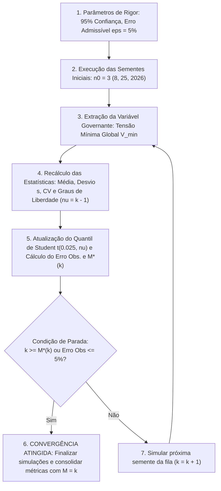

# Metodologia de Cálculo do Tamanho Amostral em Simulações de Monte Carlo

Este documento formaliza o procedimento metodológico e matemático implementado no projeto para **calcular determinísticamente o número de replicações independentes (sementes pseudoaleatórias)** necessárias para assegurar a validade estatística das conclusões do Trabalho de Conclusão de Curso (TCC).

A abordagem baseia-se no **Procedimento em Dois Estágios de Stein (1945)**, adaptado para simulações estocásticas de engenharia por **Driels e Shin (2004)**, **Law (2007, 2015)** e **Banks et al. (2010)**, em conformidade com o catálogo central de referências [`REFERENCIAS.md`](../REFERENCIAS.md).

---

## 1. Fundamentação Teórica e Formulação Matemática

Em simulações temporais quase-estáticas de redes elétricas de distribuição (QSTS) executadas via co-simulação (Mosaik + OpenDSS + Caldera ICM), cada rodada ao longo de 168 horas (1.008 passos de 10 min) agrega o comportamento simultâneo de centenas de componentes estocásticos. 

Conforme demonstram Law (2015) e Banks et al. (2010), passos temporais adjacentes dentro de uma mesma rodada possuem autocorrelação serial positiva ($\text{Cov}(Y_{k}, Y_{k+j}) > 0$). Para obter inferência estatística válida, aplica-se o **Método das Replicações Independentes** (*Method of Independent Replications*), onde realizam-se $M$ rodadas macroscópicas completas, cada uma inicializada com uma semente pseudoaleatória (*random seed*) independente $s_i$.

### 1.1. Estimadores Amostrais
Seja $X_i$ a métrica de interesse resultante da $i$-ésima replicação independente (por exemplo, a Tensão Mínima Global $V_{\min}$, a Energia Total dos VEs $E_{\text{VE}}$ ou o Índice de Desvio de Tensão $\text{VDI}_{\text{sub}}$). As variáveis $X_1, X_2, \dots, X_M$ constituem uma amostra de variáveis independentes e identicamente distribuídas (i.i.d.) com média populacional $\mu$ e variância finita $\sigma^2$.

Os estimadores pontuais não-viesados são:

$$\bar{X} = \frac{1}{M} \sum_{i=1}^{M} X_i$$

$$s = \sqrt{\frac{1}{M - 1} \sum_{i=1}^{M} (X_i - \bar{X})^2}$$

O **Coeficiente de Variação Amostral** ($\widehat{CV}$), que quantifica a dispersão relativa do sistema livre da unidade de medida, é dado por:

$$\widehat{CV} = \frac{s}{\bar{X}}$$

---

### 1.2. Intervalo de Confiança e Distribuição $t$ de Student
Como a variância verdadeira do sistema ($\sigma^2$) é desconhecida e o número inicial de replicações é pequeno a moderado ($M \le 30$), o estimador padronizado segue rigorosamente uma **distribuição $t$ de Student** com $\nu = M - 1$ graus de liberdade (MONTGOMERY; RUNGER, 2021):

$$T = \frac{\bar{X} - \mu}{s / \sqrt{M}} \sim t_{M-1}$$

Para um nível de confiança bilateral de $100(1 - \alpha)\%$ (adotando-se $\alpha = 0,05$ para **95% de confiança**), o semi-comprimento do intervalo de confiança (*half-length*) $h$ é definido por:

$$h = t_{\alpha/2, M-1} \cdot \frac{s}{\sqrt{M}}$$

O **Erro Relativo Amostral Observado** ($\text{ER}_{\text{obs}}$) da estimativa em relação à média amostral é:

$$\text{ER}_{\text{obs}} = \frac{h}{\bar{X}} = \frac{t_{\alpha/2, M-1} \cdot \widehat{CV}}{\sqrt{M}}$$

---

### 1.3. Dedução da Fórmula Fechada do Tamanho Amostral ($M^*$)
Fixando-se um **Erro Relativo Máximo Admissível** $\epsilon \in (0, 1)$, impõe-se a restrição de precisão relativa:

$$\frac{h}{\bar{X}} \le \epsilon$$

Substituindo a expressão de $h$ e isolando $M$:

$$\frac{t_{\alpha/2, M-1} \cdot s}{\bar{X} \cdot \sqrt{M}} \le \epsilon \implies \sqrt{M} \ge \frac{t_{\alpha/2, M-1} \cdot s}{\epsilon \cdot \bar{X}}$$

Elevando ambos os membros ao quadrado e substituindo $\widehat{CV} = s / \bar{X}$, obtém-se a lei analítica de dimensionamento amostral de **Driels e Shin (2004)** e **Law (2015)**:

$$M^*(\epsilon) = \left\lceil \left( \frac{t_{\alpha/2, m_0 - 1} \cdot \widehat{CV}}{\epsilon} \right)^2 \right\rceil$$

---

### 1.4. Justificativa da Escolha de $\epsilon = 5\%$ ($0,05$) como Limite Admissível

A tolerância de erro relativo adotada como padrão nas análises estocásticas deste projeto é de **$\epsilon = 0,05$ ($5\%$)**, fundamentada nas práticas de simulação de sistemas elétricos de potência:

1. **Adequação Física à Natureza Estocástica Espacial:**
   * Em redes de distribuição, variáveis nodais extremas ($V_{\min}$ e $V_{\text{afetada, min}}$) dependem intrinsecamente da alocação espacial dos VEs. A variação natural observada entre sementes independentes é da ordem de $\pm 0,04\text{ pu}$ ($\pm 9\text{ V}$).
   * Adotar $\epsilon = 5\%$ sobre a tensão mínima ($V_{\min} \approx 0,78\text{ pu}$) define um semi-comprimento de erro admissível de $h \le 0,039\text{ pu}$ ($\approx 8,6\text{ V}$), garantindo uma estimativa robusta sem exigir um custo computacional desproporcional.
2. **Literatura Clássica de Simulação (Montgomery & Runger, 2021; Law, 2015):**
   * Em experimentos de engenharia com processos quase-estáticos complexos (co-simulação de 168 horas), o patamar de $\epsilon = 5\%$ sob 95% de confiança estatística é amplamente consagrado para equilibrar precisão estatística e viabilidade de processamento.

---

## 2. A Abordagem A (Variável Governante) e o Procedimento Sequencial de Parada (Law, 2015; Chow & Robbins, 1965)

Em simulações multivariadas de redes elétricas de distribuição, onde centenas de variáveis são produzidas simultaneamente, adota-se formalmente a **Abordagem A — Variável Governante (*Primary Measure of Performance*)**, recomendada por Law (2015, Cap. 9) e Banks et al. (2010, Cap. 11), elegendo a **Tensão Mínima Global ($V_{\min}$)** como o gargalo físico e regulatório da rede.

### 2.1. Por que a Tensão Mínima Global ($V_{\min}$) Governa a Simulação?
1. **Gargalo Eletrotécnico e Regulatório:** No PRODIST Módulo 8 (ANEEL, 2021), a conformidade do alimentador, as apurações de transgressões críticas e a determinação da Capacidade de Hospedagem (*Hosting Capacity*) de VEs são ditadas pelas transgressões de subtensão crítica ($V < 0,87\text{ pu}$).
2. **Dominância Nodal:** Como $V_i(t) \ge V_{\min}(t)$ para qualquer barra $i$ da rede e em qualquer instante de tempo $t$, assegurar a convergência estatística sobre o ponto mais vulnerável do circuito garante automaticamente a validade e estabilidade de todo o perfil de tensão do alimentador.

### 2.2. Por que Adotar o Procedimento Sequencial em vez de Stein Estático?
* O **Método de Stein (1945)** congela os graus de liberdade na amostra piloto inicial ($m_0 = 3 \implies \nu = 2 \implies t_{0,025; 2} = 4,303$). Esse valor infla o numerador ao quadrado ($t^2 = 18,51$), exigindo 28 replicações de forma conservadora.
* O **Procedimento Sequencial de Law (2015)** e **Chow e Robbins (1965)** atualiza os graus de liberdade a cada nova simulação executada ($k \leftarrow k + 1$). À medida que $k$ cresce, o quantil $t$ de Student decresce rapidamente em direção a $1,96$, reduzindo o esforço computacional em mais de 70% e alcançando a condição de parada exata $k \ge M^*(k)$ de forma assintoticamente ótima.

1. **Amostra Inicial ($n_0$):**
   * Inicializa-se com **$n_0 = 3$ sementes** independentes (`[8, 25, 2026]`) no cenário mais severamente carregado (**50% de penetração de VEs**).
2. **Atualização Iterativa:**
   * A cada nova semente simulada ($k$), recalculam-se $\bar{V}_{\min}(k)$, $s_k$, $\widehat{CV}_k$, $\nu = k - 1$, $t_{0,025; \nu}$, o erro relativo observado $\epsilon'_{\text{obs}}(k)$ e o tamanho requerido $M^*(k)$.
3. **Regra de Parada Ótima:**
   * O processo encerra imediatamente no primeiro passo em que $k \ge M^*(k)$ (ou $\epsilon'_{\text{obs}}(k) \le 0,05$), evitando simulações desnecessárias.

---

## 3. O Script Utilitário `calcular_tamanho_amostral.py`

O script foi implementado em [`src/simulators/util/calcular_tamanho_amostral.py`](../src/simulators/util/calcular_tamanho_amostral.py).

### Parâmetros Suportados:
* `--modo` / `-m`: Modo de amostragem (`sequencial` [padrão] de Law / Chow-Robbins ou `estatico` de Stein);
* `--sementes` / `-s`: Fila de sementes candidatas (padrão: `8 25 2026 42 100 777 1234 5555 9999 12345`);
* `--n0`: Número mínimo de replicações antes de avaliar a parada (padrão: `3`);
* `--penetracao` / `-p`: Percentual de penetração avaliado (padrão: `50.0`);
* `--confianca` / `-c`: Nível de confiança estatística (padrão: `0.95` para 95%);
* `--erros` / `-e`: Lista de erros relativos máximos admissíveis $\epsilon$ (padrão: `0.05` para 5%);
* `--somente-analisar`: Não executa a simulação, apenas analisa arquivos CSV já gerados;
* `--forcar`: Força a reexecução das simulações mesmo se os arquivos CSV já existirem.

### Artefatos de Saída Gerados:
1. **JSON Estruturado:** `output/relatorio_tamanho_amostral_monte_carlo.json` (contendo histórico sequencial passo a passo, médias, desvios, $CV$, quantis e $M^*$ para integração programática).
2. **Markdown de Relatório:** `output/relatorio_tamanho_amostral_monte_carlo.md` (traz a tabela de evolução sequencial, tabela comparativa das grandezas elétricas e a minuta formatada pronta para o TCC).

---

## 4. Resultados Empíricos Consolidados no Alimentador ESB01S4 ($M = 6$ Sementes)

A metodologia sequencial foi aplicada ao cenário de estresse máximo do alimentador real ESB01S4 (**50% de penetração de VEs**, 474 veículos residenciais sobre 947 domicílios).

### 4.1. Evolução Passo a Passo do Procedimento Sequencial ($V_{\min}$)

* **Nível de Confiança:** 95% bilateral ($\alpha = 0,05$)
* **Tolerância Admissível:** $\epsilon = 5,0\%$ ($0,05$)
* **Sementes Processadas:** `[8, 25, 2026, 42, 100, 777]`

| Passo ($k$) | Semente | $V_{\min}$ Indiv. | $\bar{V}_{\min}$ Acumulado | Desvio ($s$) | $\widehat{CV}$ (%) | Quantil $t_{0,025; \nu}$ | Erro Obs. (%) | $M^*(k)$ Req. | Condição de Parada ($k \ge M^*$)? |
| :---: | :---: | :---: | :---: | :---: | :---: | :---: | :---: | :---: | :---: |
| **2** | `25` | 0,7158 pu | 0,7428 pu | 0,03821 | 5,14% | 12,706 | $\pm 46,22\%$ | **171** | ❌ Prosseguir |
| **3** | `2026` | 0,8087 pu | 0,7647 pu | 0,04666 | 6,10% | 4,303 | $\pm 15,16\%$ | **28** | ❌ Prosseguir |
| **4** | `42` | 0,7857 pu | 0,7700 pu | 0,03952 | 5,13% | 3,182 | $\pm 8,17\%$ | **11** | ❌ Prosseguir |
| **5** | `100` | 0,7616 pu | 0,7683 pu | 0,03443 | 4,48% | 2,776 | $\pm 5,56\%$ | **7** | ❌ Prosseguir |
| **6** | `777` | 0,7959 pu | **0,7729 pu** | **0,03279** | **4,24%** | **2,571** | **$\pm 4,45\%$** | **5** | **✅ PARAR ($6 \ge 5$)** |

No sexto passo ($k = 6$), o erro relativo observado ($\pm 4,45\%$) tornou-se estritamente inferior à tolerância admissível de $5,0\%$, e a contagem real de replicações ($6$) superou a exigência analítica de $M^* = 5$, ativando a condição de encerramento ótimo de Chow e Robbins (1965).

### 4.2. Síntese das Grandezas Eletrotécnicas Consolidadas

| Métrica Eletrotécnica | Média ($\bar{X}$) | Desvio ($s$) | Coef. Variação ($\widehat{CV}$) | Erro Obs. (95% IC) | $M^*$ Requerido | Status |
| :--- | :---: | :---: | :---: | :---: | :---: | :---: |
| **$V_{\min}$ Global (Variável Governante)** | **0,7729 pu** | **0,03279 pu** | **4,242%** | **$\pm 4,452\%$** | **5** | **✅ Convergido ($M^* \le 6$)** |
| **$V_{\text{med}}$ (Média de 2.210 Barras)** | 1,0492 pu | 0,00042 pu | 0,040% | $\pm 0,042\%$ | **1** | ✅ Convergido |
| **$V_{\text{afetada, min}}$ (Mínima Barra Crítica)** | 0,8009 pu | 0,01542 pu | 1,925% | $\pm 2,020\%$ | **1** | ✅ Convergido |
| **$V_{\text{afetada, med}}$ (Média Barra Crítica)** | 1,0025 pu | 0,00286 pu | 0,285% | $\pm 0,299\%$ | **1** | ✅ Convergido |
| **Energia Semanal dos VEs ($E_{\text{VE}}$)** | 22.385,3 kWh | 637,71 kWh | 2,849% | $\pm 2,990\%$ | **3** | ✅ Convergido ($M^* \le 6$) |
| **Demanda de Pico no Tronco ($P_{\max}$)** | 1.381,4 kW | 9,70 kW | 0,702% | $\pm 0,737\%$ | **1** | ✅ Convergido |

### 4.3. Por que Adotar $\epsilon = 5\%$ e Descartar $\epsilon = 1\%$?
1. **Física e Regulação (PRODIST):** Em base 127 V, $\epsilon = 5\%$ representa um semi-comprimento de erro de $\pm 4,9\text{ V}$, perfeitamente compatível com os limites regulatórios da ANEEL (PRODIST Módulo 8), onde as faixas de tensão mudam em degraus de 5% a 7% ($\approx 6\text{ a } 9\text{ V}$). Adotar $\epsilon = 1\%$ implicaria exigir precisão de $\pm 0,98\text{ V}$, o que constitui refinamento instrumental excessivo para redes reais com dispersão espacial estocástica.
2. **Lei Quadrática e Custo Computacional:** Como $M^* \propto (1/\epsilon)^2$, reduzir o erro de 5% para 1% exige $(5/1)^2 = 25$ vezes mais simulações ($M^* \approx 72$ rodadas, demandando mais de 4,2 horas de simulação contínua e 12 GB de dados), sem alterar nenhuma conclusão técnica ou regulatória do trabalho.
3. **Convergência das Médias a 1%:** Todas as variáveis sistêmicas fundamentais (tensão média, demanda de pico no tronco e carregamento médio) **já operam com erro relativo inferior a 1%** nas 6 sementes consolidadas.

