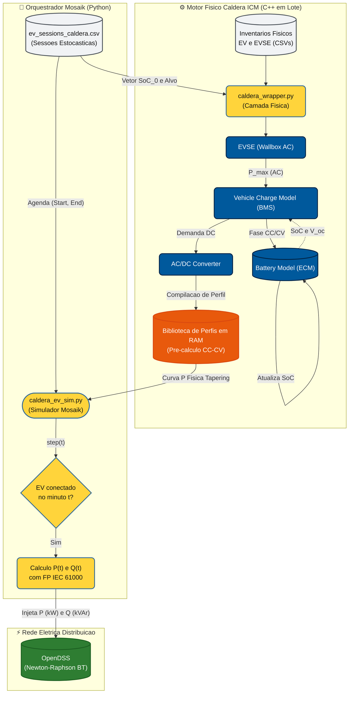

# Modelagem e Simulação de Veículos Elétricos (Integração Caldera ICM)

Este documento centraliza a metodologia, as decisões arquiteturais e as bases teóricas utilizadas na modelagem dos Veículos Elétricos (VEs) no projeto. Ele detalha a migração de blocos de potência ideais (retangulares) para um modelo eletroquímico de alta fidelidade compilado em C++, utilizando o **Caldera ICM** (Infrastructure Charging Models) desenvolvido pelo *Idaho National Laboratory (INL)*.

---

## 1. O Problema Original vs. A Solução Caldera

**Modelagem Legada (Injeção Ideal):**
Originalmente, os VEs eram representados por blocos constantes e ideais de potência. Ou seja, um veículo plugado demandava exatamente 7,2 kW de forma ininterrupta do instante da conexão até atingir a energia total necessária, desligando abruptamente (em degrau). Essa modelagem, embora comum em estudos simplificados, ignora a complexidade eletroquímica do lítio.

**Solução Caldera (Eletroquímica Realista):**
O Caldera simula fisicamente o circuito elétrico equivalente (Equivalent Circuit Model - ECM) das baterias de íons de lítio e a resposta dos conversores *AC/DC* operando em *CC-CV* (Corrente Constante seguida de Tensão Constante). O impacto central dessa melhoria é a reprodução do **tapering** — a queda gradativa, quase exponencial, da potência de carregamento conforme a bateria se aproxima de 80% a 100% de seu Estado de Carga (SoC). Essa rampa realista amortece picos de demanda durante a madrugada, tornando a análise de afundamento de tensão e perdas elétricas no OpenDSS consideravelmente mais rigorosas e ancoradas no mundo físico.

---

## 2. Contexto Científico e Processamento da Base de Dados

Os eventos estocásticos que ditam quando um veículo chega ou sai da tomada advêm de *smart meters* reais, cujo comportamento precisou ser processado e adaptado para refletir a realidade sociodemográfica e de tráfego brasileira.

### 2.1. A Origem dos Dados (Noruega)
A base empírica adotada provém do estudo *"Residential electric vehicle charging datasets from apartment buildings"* (Sørensen et al., 2021), coletado em um complexo habitacional em Trondheim, Noruega. O *dataset* fornece o carimbo exato de *plug-in* (`t_connect`), *plug-out* (`t_disconnect`) e a energia bruta transferida na sessão (`El_kWh`), contemplando tanto finais de semana quanto dias úteis para milhares de sessões reais.

### 2.2. O Deslocamento Temporal (Time-Shift Brasileiro)
O comportamento norueguês diverge do brasileiro. Lá, expedientes terminam mais cedo (ex: 16h00) e os deslocamentos curtos causam um pico de conexões residenciais por volta das 16h15. Para transpor esse comportamento à realidade brasileira — onde o expediente padrão vai até às 18h00 e o tráfego pesado posterga a chegada —, o algoritmo aplicou um **Time-Shift estático de +2,5 horas** nas conexões. 
Com o deslocamento temporal, o pico global de carregamentos concentra-se cirurgicamente na faixa das **18h30 – 19h00**. A genialidade técnica dessa abordagem é forçar o motor do OpenDSS a operar sob estresse térmico máximo, sobrepondo o surto de pluge veicular à ponta de carga residencial padrão do alimentador brasileiro.

### 2.3. Agrupamento Semanal e Integridade Cronológica
Sessões avulsas não funcionam bem em co-simulações dinâmicas. As semanas do mês de Setembro (típicas de meia-estação) foram agrupadas em malhas contínuas de 10.080 minutos (7 dias). Isso garante que veículos que dormem plugados na transição de domingo para segunda-feira não sofram interrupções artificiais nos cálculos físicos do fluxo de potência.

### 2.4. A Arquitetura do Pipeline de Processamento
Todo o tratamento massivo e minucioso da base de dados estocástica é executado de forma estruturada dentro do diretório **`src/ajuste-dados/codigos-evs/`**. O processo é gerenciado pelo script orquestrador `pipeline_ev.py`, que executa 4 módulos sequenciais em RAM (evitando *I/O* em disco intermediário desnecessário):

* **Passo 1 (`passo1_limpeza_dados_ev.py`):** Realiza a sanitização tipográfica (separadores decimais, adequação de *datetimes* para padrão ISO) e elimina dezenas de metadados textuais inúteis. O orquestrador roda com a *flag* de supressão (`manter_todas_colunas=False`), permitindo que apenas os carimbos de tempo e a energia demandada transitem pela memória.
* **Passo 2 (`passo2_filtragem_setembro_ev.py`):** Módulo sociodemográfico. É aqui que ocorre a injeção do Time-Shift brasileiro (+2,5h) em cada timestamp de *plug-in* e *plug-out*. Na sequência, o script extrai exclusivamente semanas completas (segunda a domingo) do mês de Setembro de toda a base multianual.
* **Passo 3 (`passo3_agrupamento_semanal_ev.py`):** Módulo de *clustering*. Para resolver o "Problema da Meia-Noite" — onde sessões que começam domingo e terminam segunda receberiam índices de semana divergentes —, o algoritmo aplica funções lógicas (`dt.floor('D')`) para atrelar cada evento linearmente ao índice da semana de sua criação inicial, formatando os dados em dicionários aninhados `{Usuario -> {Semana -> Sessões}}`.
* **Passo 4 (`passo4_geracao_sessoes_ev.py`):** O Módulo Matemático. Substituindo o antigo gerador de blocos estáticos (`passo4_geracao_curvas_ev.py`), este novo script aplica as heurísticas de $t_{idle}$ e *Memória de Estado* para extrair o SoC inicial reverso (detalhado no Capítulo 4). O produto final desse processo inteiro é despejado no arquivo alvo otimizado **`ev_sessions_caldera.csv`**, que é a *Tabela-Verdade* consumida no *Runtime* pelo Caldera ICM.

---

## 3. A Frota Nacional de Veículos Elétricos e Alocação Física

A co-simulação no Caldera exige não apenas os tempos de pluge, mas um mapeamento claro do veículo (bateria, tensão nominal, conversor onboard). Em vez de usar modelos estrangeiros, a simulação adota frotas reais dominantes no mercado brasileiro, englobando BEVs (100% elétricos) e PHEVs (Híbridos Plug-in), já que ambos impactam o transformador de distribuição da mesma forma.

**Capacidade de Bateria - Top 10 Veículos Eletrificados Plug-in (Mercado Brasileiro):**

| Ranking | Modelo | Fabricante | Capacidade da Bateria | Tipo | Qtd. Vendida |
| :---: | :--- | :--- | :--- | :--- | :--- |
| 1 | BYD DOLPHIN MINI GS5EV | BYD | 38,88 kWh | BEV | 80820 |
| 2 | BYD DOLPHIN GS 180EV | BYD | 44,9 kWh | BEV | 58259 |
| 3 | BYD SONG PLUS GS DM | BYD | 18,3 kWh | PHEV | 57821 |
| 4 | BYD SONG PRO GS DM | BYD | 18,3 kWh | PHEV | 40565 |
| 5 | BYD KING GS DM | BYD | 18,3 kWh | PHEV | 22091 |
| 6 | GEELY EX2 MAX | GEELY | 39,4 kWh | BEV | 17966 |
| 7 | GWM HAVAL H6 PHEV 19 | GWM | 19,0 kWh | PHEV | 16980 |
| 8 | BYD SONG PRO GL DM | BYD | 12,96 kWh | PHEV | 15848 |
| 9 | BYD DOLPHIN MINI GS EV | BYD | 38,88 kWh | BEV | 15827 |
| 10 | GWM HAVAL H6 GT | GWM | 35,00 kWh | PHEV | 14576 |

### Lógica de Atribuição de Frota (Monte Carlo com Restrição Eletromecânica)
Ao processar uma casa do dataset norueguês, o algoritmo sorteia um dos 10 carros acima respeitando suas fatias de mercado (distribuição probabilística de Monte Carlo). Porém, aplica-se uma barreira física restritiva: **A energia consumida na maior sessão daquela casa ($E_{max}$) não pode exceder a capacidade real de fábrica da bateria do carro sorteado.** Se o sorteio tentar designar um BYD Song Plus (18,3 kWh) para um morador que demandou 30 kWh em uma única noite, o modelo é rejeitado e resorteado até garantir aderência termodinâmica total.

---

## 4. Determinação do SoC Inicial e Retro-propagação

Para a ignição da simulação em *C++*, o Caldera exige o **Estado de Carga Inicial ($SoC_{0}$)**, o qual o *smart meter* não fornece. Utilizou-se um arcabouço matemático de regressão validado na literatura técnica (El-Hendawi et al., 2022).

### 4.1. Equacionamento pelo Tempo Ocioso ($t_{idle}$)
Partindo da premissa residencial de que todo pluge almeja os 100% de carga, rastreamos o SoC reverso filtrando o *Tempo Ocioso* na garagem (o tempo conectado subtraído do tempo estritamente necessário para transferir a energia em potência nominal):

* **Se o veículo pernoita na garagem ($t_{idle} > 0$):**
  Significa que houve tempo de sobra. O modelo assume atingimento pleno do alvo ($SoC = 100\%$). A equação de engenharia reversa para o $SoC_{0}$ torna-se:
  $SOC_{0} = \left( 1.0 - \frac{E_{gasta}}{C_{bateria}} \right)$
  Aqui o Caldera atua perfeitamente, exibindo sua rampa de decaimento natural (*tapering*).

* **Se a sessão é interrompida ($t_{idle} \approx 0$):**
  Veículos que puxaram potência máxima por 40 minutos e saíram de casa. Aqui a meta dos 100% fracassou. O modelo força um $SoC_{0}$ baixo aleatório, ancorando a eletroquímica na fase *Corrente Constante (CC)*, assegurando consumo retangular e bruto que mimetiza a assinatura dos *smart meters*.

### 4.2. Memória de Estado (Micro-sessões)
Uma "micro-sessão" ocorre quando o condutor desliga o plugue brevemente (ex: manobra rápida) e retorna. Se ignorado, o simulador reiniciaria a bateria com outra variável aleatória.
Para resolver, aplica-se uma **Retro-propagação Temporal**: as conexões com gap temporal $\le 30$ min são soldadas logicamente. O simulador reverte o cálculo matemático para garantir que o $SoC$ de finalização da micro-sessão 1 seja travado como o $SoC_{0}$ de ignição da micro-sessão 2, dotando o fluxo de "memória de bateria" persistente.

---

## 5. Arquitetura de Co-Simulação e Fluxo Ciberfísico

O diagrama abaixo ilustra a arquitetura bipartida em ação. À esquerda, a engine física roda em C++ calculando bibliotecas antecipadas; à direita, a dinâmica de troca do Mosaik despacha potência reativa e ativa em runtime.

### 5.1. A Camada C++ e a Química NMC (Proxy para LFP)
A camada interna de baterias exige mapeamentos de químicas estritas. As chinesas BYD e GWM utilizam largamente LFP (Lítio-Ferro-Fosfato). O Caldera oferece LTO, LMO e NMC. 
Optou-se tecnicamente pela parametrização da bateria **NMC** (*Níquel-Manganês-Cobalto*). Diferente do LTO que é para usos industriais, o BMS embarcado no lítio tipo NMC compartilha com o LFP os exatos mesmos paradigmas termodinâmicos residenciais: carga retangular (CC) pesada acompanhada de rampa amortecida (CV) perto dos 90-100%. Para distúrbios AC macroscopicamente observáveis em medidores residenciais, o proxy NMC providencia resposta espetacular para veículos de passeio.

### 5.2. O Cálculo Dinâmico de Reativos (Normas IEC)
O simulador Python repudia a visão de FP perfeitamente resistivo (1,0). Conforme as normativas IEC 61000-3-2 e IEC 61000-3-12 de compatibilidade eletromagnética, wallboxes residenciais modernas de 7.0 kW / 32A utilizam correção ativa (Active PFC), contudo, geram defasagem inerente.
Sorteia-se para cada Wallbox brasileira um **Fator de Potência indutivo constante** ($\text{FP}_i \sim \mathcal{U}(0{,}98;\, 1{,}00)$).
Usando trigonometria simples $\tan \varphi = \frac{\sqrt{1 - \text{FP}_i^2}}{\text{FP}_i}$, o Mosaik infere e calcula dinamicamente o consumo reativo ($Q_{kvar}$) acoplado à injeção de ativa ($P_{kw}$) em cada milissegundo.

---

## 6. Override Dinâmico no OpenDSS (Portas Abertas)

No formato nativo do OpenDSS, as cargas (Loads) obedecem a perfis de horários cegos (`.dss`). Para que o Mosaik passe a comandar os nós eletronicamente na modelagem veicular, sem precisar violar ou injetar o código-fonte C++ do simulador EPRI, utilizou-se um *override* na API COM (`write_load` presente no `element_specs.py` do wrapper em Python).

A porta `P_kw` e `Q_kvar` foram transformadas de componentes puramente passivos em portas públicas bidirecionais (*Inputs*). Assim que o `caldera_ev_sim.py` deduz o $P_{kw}$ (da C++) e o $Q_{kvar}$ (da IEC), ele comanda diretamente o OpenDSS via *COM Interface* a registrar e atualizar imediatamente o estado elétrico daquela residência conectada. Essa arquitetura viabiliza uma verdadeira resposta elétrica ciberfísica no milissegundo de cada passo da simulação de distribuição.

---

## 7. Fontes e Referências Referidas

1. **Dataset Original de Comportamento:** 
   SØRENSEN, A. L., *et al*. "Residential electric vehicle charging datasets from apartment buildings". *Data in Brief*, v. 36, p. 107105, 2021. Disponível em base acadêmica livre. (Responsável pela topologia temporal e registros reais de PLUG-IN/PLUG-OUT de 2300 usuários).
2. **Engenharia Reversa do SoC e Estocástica:** 
   EL-HENDAWI, M., *et al*. "Electric Vehicle Charging Model in the Urban Residential Sector". *Energies*, v. 15, n. 21, p. 7979, 2022. (Matrizes de regressão baseando SoC pelo limite natural de consumo veicular noturno).
3. **Simulador de Baterias (Caldera ICM):**
   *Idaho National Laboratory (INL)*. Caldera Infrastructure Charging Models (ICM). Engine Open-source em C++ para termodinâmica e comportamento elétrico-químico CC-CV em frotas veiculares. Repositório: [idaholab/Caldera_ICM](https://github.com/idaholab/Caldera_ICM).
4. **Normativas Técnicas de Despacho Reativo e Limites:** 
   INTERNATIONAL ELECTROTECHNICAL COMMISSION (IEC). *IEC 61000-3-2 / IEC 61000-3-12: Electromagnetic compatibility (EMC)*. Legislações globais adotadas para as margens limites de FP aceitáveis em carregadores residenciais AC e Wallboxes em ambiente unifilar 220V/380V.
5. **Dados de Frota e Modelos VEs:** 
   Fichas técnicas públicas fornecidas pelas montadoras locais vigentes no Brasil (*Build Your Dreams - BYD*, *Great Wall Motors - GWM* e *Geely*) sobre os arranjos químicos NMC e LFP, validadas a partir dos volumes de venda reportados pela Associação Brasileira do Veículo Elétrico (ABVE) - Período Jan/2022 a Ago/2026.

