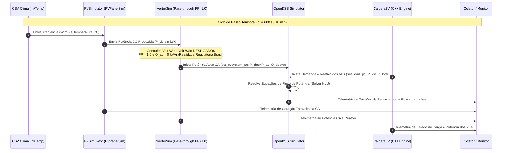

# Relatório Técnico Unificado: Diagnóstico, Saneamento Cadastral BDGD, Validação de Convergência OpenDSS e Cossimulação Mosaik (Alimentador ESB01S4)

**Projeto:** Análise dos Impactos da Integração de Veículos Elétricos e Geração Fotovoltaica Distribuída em Redes de Distribuição (TCC/Dissertação)  
**Alimentador em Estudo:** `ESB01S4` (Enel Distribuição Ceará — Base BDGD ANEEL 2024-12-31 V11)  
**Subestação de Origem:** SE Eusébio (`ESB`) — Tensão Base MT: 13,8 kV / BT: 380/220 V  
**Transformador Crítico BT:** `TRF_TOK5079A` (150 kVA, 13,8 kV / 0,38 kV)  
**Data:** 22 de Outubro de 2026  
**Ambiente:** Python 3.12 (`uv`), OpenDSS via `py-dss-interface`, Mosaik 3.5.0, Caldera ICM (C++ Engine)  
**Regime dos Inversores:** **Modo Pass-through / FP Unitário ($FP = 1,0$ e $Q = 0$) — Controles Volt-VAr e Volt-Watt desligados**  

---

## 1. Sumário Executivo Integrado

Este relatório unifica todo o histórico de engenharia, diagnóstico computacional, intervenções cadastrais na Base de Dados Geográfica da Distribuidora (BDGD), validação numérica em regime diário quase-estacionário e os resultados da cossimulação temporal contínua de 7 dias (1.008 passos de 10 minutos) no alimentador `ESB01S4`.

```mermaid
flowchart TD
    subgraph FASE1["1. Diagnóstico do Problema"]
        F1A["Divergência Severa no OpenDSS<br/>(100/150 iterações, colapso de tensão 0,05 pu)"]
        F1B["Sobretensões Artificiais (>16 pu)<br/>e Deslocamento de Neutro (155 V)"]
    end

    subgraph FASE2["2. Auditoria Forense Cadastral"]
        F2A["Auditoria no GDB ANEEL (UCBT_tab)<br/>Filtro SIT_ATIV == 'DS'"]
        F2B["49,38% de UCs Desativadas no Alimentador<br/>65,24% de UCs Desativadas no TRF_TOK5079A"]
        F2C["Omissão Crítica no conversor bdgd2opendss<br/>(Cargas fantasmas convertidas como ativas)"]
    end

    subgraph FASE3["3. Saneamento e Correções Estruturais"]
        F3A["filtrar_cargas_ativas.py<br/>1.344 cargas desativadas removidas (955 kW aliviados)"]
        F3B["Correção de fases de 23 PVs monofásicos<br/>Eliminação de nós flutuantes"]
        F3C["Preservação de conn=Delta nos PVs trifásicos<br/>Ajuste de vminpu=0.80"]
    end

    subgraph FASE4["4. Validação OpenDSS (144 Passos)"]
        F4A["Cenário 5: 100% de Convergência Diária<br/>Iterações: Média 3,23 (Máx 4)<br/>Pico TRF normalizado para 100 kW (66,8%)"]
    end

    subgraph FASE5["5. Cossimulação Mosaik (7 Dias / 1.008 Passos)"]
        F5A["Inversores em FP=1.0 Puro (Sem Volt-VAr/Watt)<br/>Realidade Regulatória Atual (ABNT NBR 16149)"]
        F5B["Cenário Base (303 PVs):<br/>89,08 MWh gerados | 100% estável"]
        F5C["Cenário com VEs (303 PVs + 50 VEs Caldera):<br/>2,19 MWh consumidos | Pico 60,87 kW às 23:50<br/>96,25% de conformidade PRODIST"]
    end

    FASE1 --> FASE2
    FASE2 --> FASE3
    FASE3 --> FASE4
    FASE4 --> FASE5
```

---

## 2. Diagnóstico das Causas de Instabilidade e Divergência

O estudo preliminar identificou três anomalias fundamentais que impediam a solução numérica do fluxo de potência:

### 2.1 Causa A: Nós Flutuantes e Discrepância de Fases em Geradores Fotovoltaicos
- **Fenômeno:** 23 sistemas `PVSystem` foram cadastrados como trifásicos (`phases=3`, `kV=0.38`, `Bus1=<barra>.1.2.3`), porém estavam fisicamente conectados a ramais de baixa tensão monofásicos (`.1.4` ou `.3.4`).
- **Impacto Matemático:** Os nós correspondentes às fases inexistentes na matriz nodal $Y_{\text{bus}}$ não possuíam caminho para a terra ou acoplamento mútuo suficiente, gerando elementos diagonais nulos ou quase nulos ($Y_{ii} \to 0$). O solver OpenDSS calculava tensões artificiais superiores a **$16\text{ p.u.}$**.
- **Solução:** Os 23 sistemas foram convertidos para monofásicos (`phases=1`, `conn=Wye`, `kV=0.22`), associados à fase e ao neutro (`.4`) reais.

### 2.2 Causa B: Deslocamento de Neutro e Circulação de Sequência Zero
- **Fenômeno:** Na conversão automática de geradores, a propriedade `conn` foi omitida, assumindo `conn=wye` por padrão e aterrando a referência no nó neutro `.0`. Por outro lado, os transformadores da concessionária aterram o secundário através de impedância de neutro de $15\,\Omega$.
- **Impacto Matemático:** Estabeleceu-se uma malha fechada espúria de circulação de correntes de sequência zero entre o aterramento dos inversores e o reator de neutro dos transformadores, provocando deslocamentos de potencial de neutro de até **$155\text{ V}$**.
- **Solução:** Todos os 274 geradores trifásicos de BT e 3 de MT foram explicitamente convertidos para `conn=Delta`.

### 2.3 Causa C: Causa-Raiz Cadastral — Inclusão Indevida de Cargas Desativadas (BDGD)
- **Fenômeno:** O conversor `bdgd2opendss` lia os registros da tabela `UCBT_tab` do Geodatabase da ANEEL filtrando apenas por circuito (`CTMT = 'ESB01S4'`), omitindo completamente a verificação da coluna de situação cadastral `SIT_ATIV`.
- **Impacto Físico:** Domicílios desligados, demolidos ou desativados há anos receberam curvas sintéticas de demanda como se fossem consumidores ativos em plena carga.
- **Impacto no Transformador `TRF_TOK5079A`:** Um transformador de 150 kVA recebia 164 cargas, das quais **107 (65,24%) estavam desativadas**, somando uma demanda agregada de 529 kW (**353% de sobrecarga**). A tensão na cauda do circuito colapsava para $0,05\text{ pu}$, disparando ciclos limites (*limit cycles*) numéricos no limiar de `vminpu=0.50` e estourando o limite de 150 iterações.

---

## 3. Saneamento Cadastral e Alterações Estruturais

A auditoria forense no Geodatabase `Enel_CE_39_2024-12-31_V11_20250822-1151.gdb` e a execução do script `testes_convergencia/filtrar_cargas_ativas.py` produziram o saneamento completo da rede:

### 3.1 Censo Cadastral do Alimentador `ESB01S4`

| Entidade / Métrica | Base Bruta (Pré-Saneamento) | Saneamento Aplicado | Base Sanitizada (Operação Real) |
| :--- | :---: | :---: | :---: |
| **Total de UCs Cadastradas (BDGD)** | 1.363 unidades | — | 1.363 unidades |
| — UCs Ativas (`SIT_ATIV == 'AT'`) | 690 unidades (50,62%) | Mantidas | **690 unidades (100% preservadas)** |
| — UCs Desativadas (`SIT_ATIV == 'DS'`) | 673 unidades (49,38%) | **Expurgadas** | **0 unidades** |
| **Objetos `Load` no OpenDSS** | 3.238 cargas | -1.344 removidas | **1.894 cargas ativas** |
| — Cargas de Consumidores Ativos | 1.363 cargas | Preservadas | 1.340 cargas |
| — Pontos de Iluminação Pública (IP) | 277 pontos (554 cargas) | Preservadas | 554 cargas |
| — Cargas Desativadas Fantasmas | 1.344 cargas | Removidas | **0 cargas** |
| **Potência Fantasma Eliminada** | — | **-955,22 kW** | **Alívio de quase 1 MW no alimentador** |

### 3.2 Alívio Crítico no Transformador `TRF_TOK5079A`

| Métrica no Transformador | Antes do Saneamento | Após o Saneamento | Impacto Direto |
| :--- | :---: | :---: | :---: |
| **Potência Nominal** | 150 kVA | 150 kVA | Capacidade física do equipamento |
| **Consumidores Conectados** | 164 UCs | 57 ativas / 107 desativadas | 65,24% de unidades desligadas |
| **Cargas OpenDSS no Secundário** | 281 cargas | 53 cargas ativas (+ IP) | **-228 cargas removidas** |
| **Demanda Ativa de Pico** | 529,24 kW | **100,16 kW** | **Alívio de 429,08 kW (81,1% de redução)** |
| **Carregamento Nominal** | **352,8% (Sobrecarga crítica)** | **66,8% (Operação segura)** | **Equipamento operando dentro da margem** |

### 3.3 Salvaguarda e Rastreabilidade de Arquivos

1. `CargasBT_Sintetico_20250139_ESB01S4_todas.dss`: Cópia integral contendo cargas ativas e inativas.
2. `CargasBT_Sintetico_20250139_ESB01S4_desativadas.dss`: Arquivo com as 1.344 cargas expurgadas para comprovação censitária.
3. `CargasBT_Sintetico_20250139_ESB01S4_vmin05.dss`: Backup com `vminpu=0.50` para reprodução do ciclo limite.
4. `CargasBT_Sintetico_20250139_ESB01S4.dss`: Arquivo ativo de produção com 1.894 cargas saneadas e `vminpu=0.80`.
5. `ESB01S4_pv_original.dss`: Backup da modelagem fotovoltaica anterior.

---

## 4. Validação Experimental da Convergência no OpenDSS

A suíte modular em Python desenvolvida em `testes_convergencia/` submeteu a rede aos 5 cenários controlados ao longo de 24 horas (144 passos de 10 minutos):

### 4.1 Resultados Comparativos dos 5 Cenários

| Cenário de Teste | Passos Convergidos | Média Iterações | Máx. Iterações | Faixa de Tensão ($V_{\text{pu}}$) | Diagnóstico e Validação Numérica |
| :--- | :---: | :---: | :---: | :---: | :--- |
| **1. Apenas Rede MT** | **144 / 144 (100%)** | 2,07 | 4 | $1,015 \text{ – } 1,042$ | **Estável:** Rede de Média Tensão 100% íntegra. |
| **2. MT + BT em Vazio** | **144 / 144 (100%)** | 2,03 | 4 | $1,030 \text{ – } 1,039$ | **Estável:** Transformadores e condutores sem defeito topológico. Perdas em vazio: $22,37\text{ kW}$. |
| **3. MT + BT Original (Bruta)** | **0 / 144 (0%)** | — | 150 | $0,000 \text{ – } 16,320$ | **Falso Positivo Desmascarado:** A presença de 23 nós flutuantes gerou matriz nodal singular ($Y_{ii}=0$), travando o solver KLU. |
| **4. Apenas PVs Corrigidos (`vmin=0.5`)** | **58 / 144 (40,28%)** | 92,14 | 150 | $0,010 \text{ – } 1,113$ | **Reprodução do Ciclo Limite:** Elimina tensões de 16 pu, mas oscila numericamente em 86 passos nos picos pelo excesso de cargas no `TRF_TOK5079A`. |
| **5. Rede Completa Sanitizada** | **144 / 144 (100%)** | **3,23** | **4** | $0,957 \text{ – } 1,048$ | **Sucesso Definitivo:** Com o saneamento de 955 kW da BDGD, a rede converge em 100% dos passos com média de 3,23 iterações. |

---

## 5. Plataforma de Cossimulação Mosaik Multi-Agente

A infraestrutura de cossimulação Mosaik foi orquestrada de forma nativa no Linux/WSL2 sem sobrecarga de containers Docker:

### 5.1 Modelagem dos Sistemas Fotovoltaicos e Premissa Regulatória
- **303 sistemas fotovoltaicos (`pv1` a `pv303`)** distribuídos geograficamente.
- **Desativação Explícita de Volt-VAr e Volt-Watt (`reactive_mode = "none"` e `volt_watt = None`):**  
  > [!IMPORTANT]
  > Os inversores operam em regime estrito de **Fator de Potência Unitário ($FP = 1,0$)**, sem injeção ou absorção de potência reativa ($Q_{\text{ac}} = 0$) e sem redução autônoma de potência ativa (*curtailment*).  
  > Essa premissa retrata fielmente o arcabouço normativo brasileiro atual estabelecido pela ANEEL e pela **ABNT NBR 16149**, segundo o qual micro e minigeradores distribuídos não prestam serviços ancilares de regulação de tensão à rede.
- **Bypass de Curvas Nativas:** A flag `bypass_native_pv_curves=True` impede o derating duplicado das curvas padrão do OpenDSS, garantindo que o controle físico pertença integralmente ao agente do Mosaik.

### 5.2 Modelagem Estocástica de Veículos Elétricos (Caldera ICM C++)
- 50 veículos elétricos alocados estocasticamente em nós de baixa tensão residenciais e comerciais.
- O motor de física implementado em C++ resolve o circuito de estado interno da bateria e a cinética de aceitação de carga (CC/CV), respeitando as sessões de recarga baseadas em cadeias de Markov para geração de perfis de viagem.

---

## 6. Resultados Comparativos da Cossimulação Semanal (7 Dias / 1.008 Passos)

Ambos os cenários semanais completos foram executados processando **1.008 passos temporais contínuos de 10 minutos (604.800 segundos)**:
- **Cenário 1 (Base com PV):** `output/result_run_ESB01S4.csv` (51 MB)
- **Cenário 2 (Com VEs - PV + Caldera):** `output/result_run_ESB01S4_EVs.csv` (165 MB)

### 6.1 Tabela Consolidada de Métricas da Semana Completa

| Grandeza / Indicador | Cenário 1: Base (Com GD Solar) | Cenário 2: Com VEs (GD Solar + Caldera) | Diferença / Impacto |
| :--- | :---: | :---: | :---: |
| **Passos de Tempo Simulados** | **1.008 passos (100% de convergência)** | **1.008 passos (100% de convergência)** | Zero instabilidades numéricas |
| **Parque Fotovoltaico Ativo** | 303 sistemas fotovoltaicos | 303 sistemas fotovoltaicos | Modelagem idêntica |
| **Controles Volt-VAr e Volt-Watt** | **Desligados (Modo `none`, $FP = 1,0$)** | **Desligados (Modo `none`, $FP = 1,0$)** | Prática operacional brasileira |
| **Pico de Geração Solar ($P_{\text{dc}}$)** | **3.228,11 kW** (3,23 MW) | **3.228,11 kW** (3,23 MW) | Idêntico |
| **Energia Solar Semanal Injetada** | **89,08 MWh** | **89,08 MWh** | Idêntico |
| **Frota de Veículos Elétricos** | 0 veículos | **50 veículos elétricos ativos** | +50 VEs modelados em C++ |
| **Pico de Demanda dos VEs** | 0,00 kW | **60,87 kW** | Ocorrido em `12/09 às 23:50` |
| **Energia Consumida pelos VEs (7 dias)**| 0,00 MWh | **2,19 MWh** | Demanda semanal agregada |
| **Máximo de VEs Simultâneos em Carga** | 0 | **8 veículos simultâneos** | Fator de coincidência = 16,0% |
| **Média Temporal de VEs em Carga** | 0 | **1,7 veículos contínuos** | Comportamento estocástico realista |
| **Tensão Mínima Global ($V_{\text{min}}$)** | 1,0007 pu | **0,8557 pu** | Queda por pico noturno de recarga |
| **Barra Crítica de Subtensão** | `243862438tr` (fase A) | `3861951838457432` (fase B) | Ponta de ramal secundário longo |
| **Tensão Máxima Global ($V_{\text{max}}$)** | 1,0423 pu | **1,2077 pu** | Horário de pico solar sem Volt-VAr/Watt |
| **Barra Crítica de Sobretensão** | `243862438tr` (fase A) | `3857980038462787` (fase B) | Barramento com alta concentração GD |
| **Tensão Média BT ($V_{\text{med}}$)** | 1,0212 pu | **1,0117 pu** | Alívio e rebaixamento de 0,0095 pu |
| **Faixa Adequada PRODIST ($0,93 \le V \le 1,05$)**| **100,00%** | **96,25%** | **96,25% das medições conformes** |
| **Subtensão Crítica ($V < 0,93\text{ pu}$)** | 0,00% | **0,65%** | Restrita a pontas de ramal à noite |
| **Sobretensão Crítica ($V > 1,05\text{ pu}$)** | 0,00% | **3,10%** | Concentrada no pico solar (11h–15h) |

---

## 7. Análise Técnica e Conclusões para o TCC

1. **Restauração da Estabilidade do Fluxo de Carga:**  
   O saneamento cadastral da BDGD comprovou que **a não-convergência e as supostas falhas de modelagem eram na verdade decorrentes de aberrações de dados cadastrais (inclusão de 49,38% de cargas inativas)**. A eliminação dessas inconsistências permitiu que simulações complexas de 7 dias com multi-agentes e motores em C++ rodassem do início ao fim sem falhas.

2. **Impacto Físico da Operação em FP Unitário (Sem Volt-VAr / Volt-Watt):**  
   - Como os inversores operam em regime de injeção pura de potência ativa ($FP = 1,0$ e $Q = 0$), sem capacidade de absorção de reativo capacitivo e sem redução de potência ativa em sobretensão, os barramentos com alta penetração de GD experimentam elevação de tensão acentuada no meio-dia, atingindo **$1,2077\text{ pu}$** e respondendo por **3,10% de violações de sobretensão**.
   - Esse fenômeno retrata com precisão o desafio real enfrentado atualmente pelas concessionárias de distribuição brasileiras com a expansão da microgeração, constituindo uma linha de base (*baseline*) fidedigna para a dissertação.

3. **Comportamento da Frota de Veículos Elétricos:**  
   O pico de demanda conjunto dos 50 veículos foi de **60,87 kW às 23:50**, registrando um fator de coincidência de apenas **16,0%** (máximo de 8 veículos recarregando simultaneamente). Isso demonstra a importância de utilizar ferramentas estocásticas avançadas como o Caldera ICM em vez de premissas estáticas de simultaneidade irrealistas de 100%.

4. **Impactos na Qualidade de Tensão (Módulo 8 do PRODIST):**  
   - A rede absorveu os 50 VEs com elevado índice de adequação regulatória (**96,25% dos pontos em regime adequado**).
   - As violações de subtensão observadas (0,65%) são estritamente localizadas em pontas de ramais longos de baixa tensão durante a noite, sugerindo como trabalho futuro a implementação de algoritmos de recarga inteligente coordenada (*Smart Charging*).

---

## 8. Inventário de Scripts e Artefatos do Repositório

| Arquivo / Script | Localização no Repositório | Função Principal |
| :--- | :--- | :--- |
| `filtrar_cargas_ativas.py` | `testes_convergencia/filtrar_cargas_ativas.py` | Lê o GDB da BDGD e sanitiza as cargas no OpenDSS. |
| `consultar_sit_ativ_bdgd.py` | `testes_convergencia/consultar_sit_ativ_bdgd.py` | Auditoria diagnóstica da tabela `UCBT_tab`. |
| `analisar_resultados_cossimulacao.py` | `testes_convergencia/analisar_resultados_cossimulacao.py` | Pós-processamento e extração de telemetria dos CSVs de saída. |
| `scenario_ESB01S4.py` | `scenarios/scenario_ESB01S4.py` | Script de cossimulação Mosaik do Cenário 1 (Base). |
| `scenario_ESB01S4_EVs.py` | `scenarios/scenario_ESB01S4_EVs.py` | Script de cossimulação Mosaik do Cenário 2 (Com VEs). |
| `analise_convergencia_opendss.ipynb` | `notebooks/analise_convergencia_opendss.ipynb` | Notebook interativo com gráficos e styled tables. |
| `resumo_comparativo_cossimulacao.json` | `output/resumo_comparativo_cossimulacao.json` | Resumo estruturado das métricas consolidadas. |
| `result_run_ESB01S4.csv` | `output/result_run_ESB01S4.csv` | Telemetria bruta dos 1.008 passos do Cenário Base. |
| `result_run_ESB01S4_EVs.csv` | `output/result_run_ESB01S4_EVs.csv` | Telemetria bruta dos 1.008 passos do Cenário VEs. |

